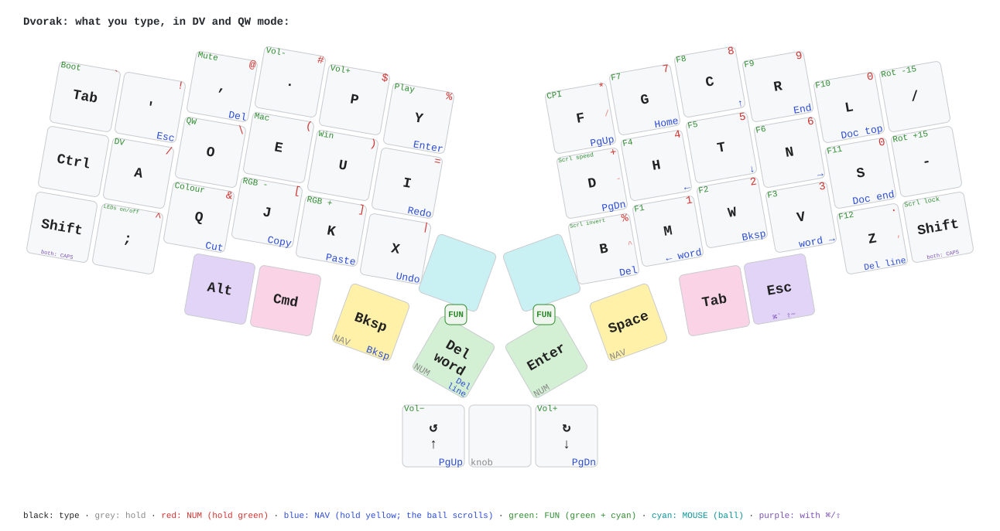

# cocot46plus

My QMK layout for aki27's [cocot46plus](https://github.com/aki27kbd/cocot46plus),
a 46-key split keyboard with a trackball, a knob and an OLED. It types Dvorak
on any computer, puts Ctrl, Alt, Cmd and Shift under the home row, and moves
everything else to the thumbs.

See it on the [project page](https://mtourne.github.io/cocot46plus/), or print
the [cheat sheet](docs/cheatsheet.pdf).



## The layout

Hold a home-row letter for a modifier. Hold a thumb key for a layer: Bksp or
Space for NAV (arrows and editing), Delete word or Enter for NUM (numpad and
symbols). A green thumb key plus the cyan key next to it gives FUN (F-keys,
media, settings). Moving the ball turns on MOUSE; holding NAV makes it
scroll.

On NUM, Shift gives the partner you'd expect: `*` and `/`, `+` and `-`,
`[` and `{`.

The board has two modes, so you type Dvorak whether the computer is set to
Dvorak (DV) or US (QW). Shortcuts stay on the Dvorak letters: ⌘C is on the
Dvorak C. A Windows mode swaps Ctrl and Win, so Ctrl+C uses the same fingers
as ⌘C.

The OLED shows the held modifiers, the layer and the mode. The
[live view](https://mtourne.github.io/cocot46plus/live.html) (Chrome) and
Cocot Live (a floating macOS panel with a menu bar icon) light up each key as
you press it.

The [keymap README](firmware/keymaps/mtourne/README.md) covers every key and
setting. [FUTURE.md](FUTURE.md) collects notes on a wireless version.

## Build and flash

You need the [QMK CLI](https://docs.qmk.fm/newbs_getting_started) and
`avrdude`.

```sh
./build.sh flash
```

The first run clones QMK 0.31.12 into `.qmk/`; set `$QMK_HOME` to use your
own checkout. When it asks for the bootloader, hold a green thumb key and the
cyan key next to it and press Boot (top left), or press reset twice.

`./build.sh` alone compiles `cocot46plus_mtourne.hex`, and GitHub Actions
builds it on every push. `./build.sh draw` redraws the cheat sheet and live
view (needs [uv](https://docs.astral.sh/uv/) and Chrome), and `./build.sh app`
builds Cocot Live.

The firmware fills the Pro Micro's flash to within 40 bytes, so a new feature
needs something else removed first.

## Credits

aki27 designed the board and wrote its QMK code. The dual-use keys come from
[dlip's engram layout](https://github.com/dlip/qmk_firmware/tree/dlip/keyboards/tamatama/keymaps/engram),
NUM follows Pascal Getreuer's
[symbol-layer notes](https://getreuer.info/posts/keyboards/symbol-layer/), and
[keymap-drawer](https://github.com/caksoylar/keymap-drawer) draws the cheat
sheet. GPL 2.0 or later, like [QMK](https://qmk.fm); see [LICENSE.md](LICENSE.md).
